<div align="center">


# pi Desktop

**[pi](https://github.com/earendil-works/pi) kodlama ajanı için masaüstü uygulaması.**<br/>
Terminalde kullandığınız aynı ajan ve aynı `~/.pi/agent` — zaman çizelgesi, Git inceleme (Review), yerleşik terminal ve telefonunuzdan devam etmek için bir Android uygulamasıyla.

[](https://github.com/justhil/pi-app/releases/latest)
[](https://github.com/justhil/pi-app/releases)

[](LICENSE)

[English](./README.md) · [简体中文](./README.zh-CN.md) · **Türkçe** · [İndir](https://github.com/justhil/pi-app/releases/latest) · [Başlangıç](./doc/guide/getting-started.md) · [Adaptörler](./doc/guide/adapters.en.md)

</div>

<picture>
  <source media="(prefers-color-scheme: dark)" srcset="doc/assets/readme/en/hero-dark.png" />
  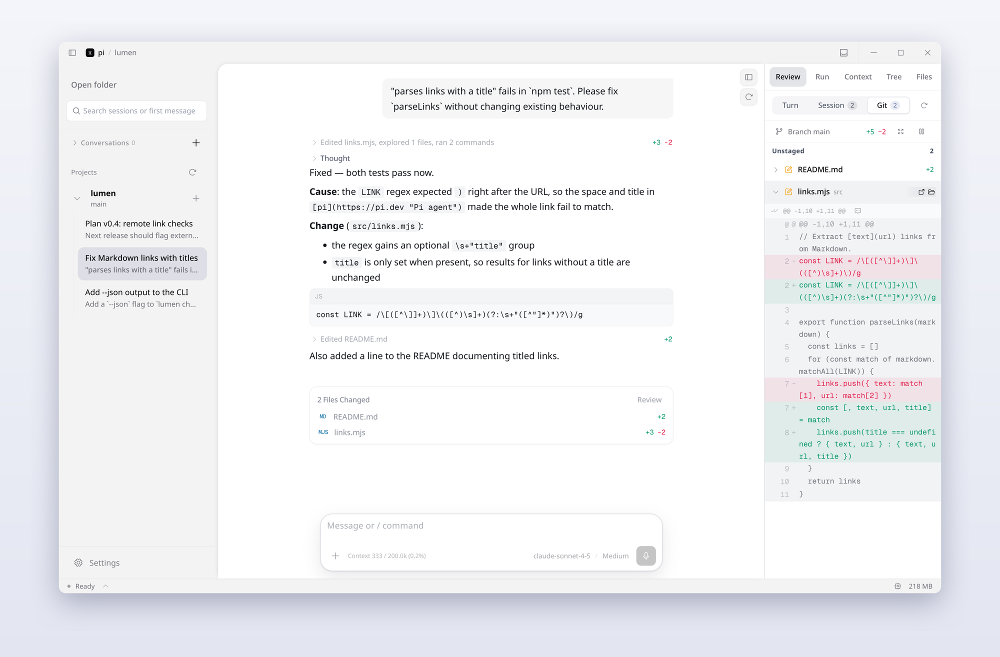
</picture>

pi Desktop başka bir ajan değildir. Arka plan çalışanında (worker) pi SDK'yı çalıştırır ve CLI ile aynı dosyaları — oturumlar, model girişleri, `settings.json`, yüklü eklentiler — okur. Bir proje açtığınızda terminalde başlattığınız oturumlar zaten kenar çubuğundadır; herhangi birine devam edebilir veya yeni bir tane başlatabilirsiniz.

## Bir bakışta

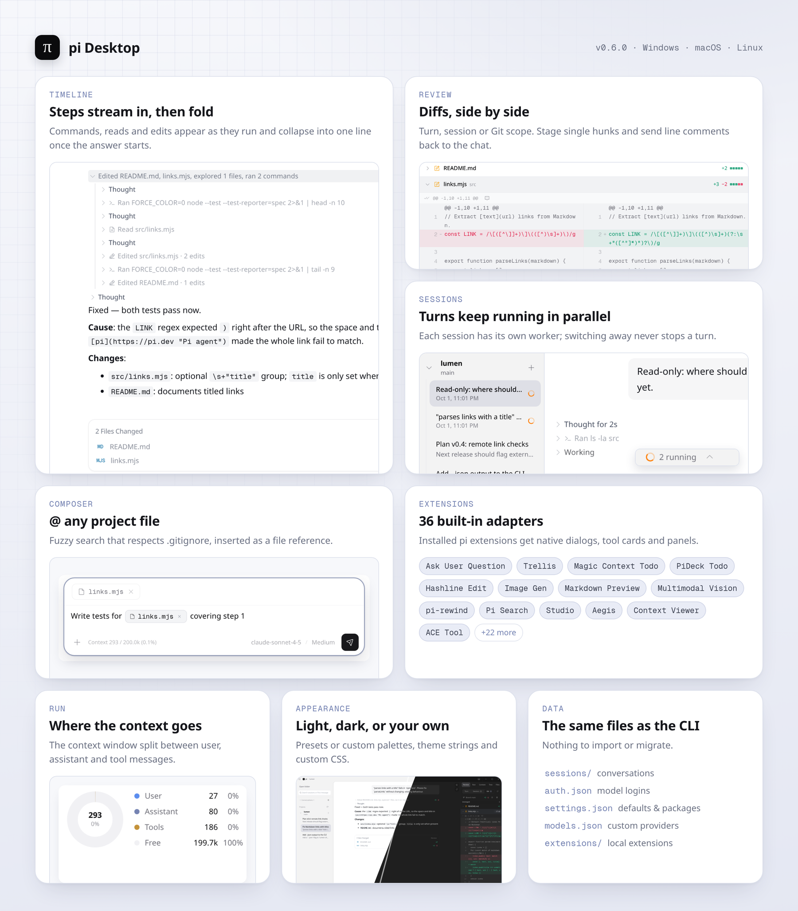

## Baştan sona bir tur

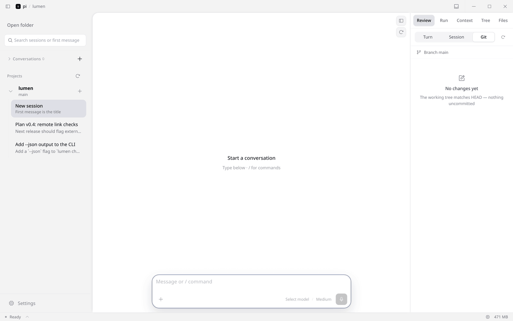

<sub>Doğrudan uygulamanın kendisinden kaydedilmiştir. Demo tekrarlanabilir olsun diye model yanıtları betiklenmiş yerel bir uç noktadan gelmektedir; <code>bash</code>, <code>read</code> ve <code>edit</code> araçları örnek depo üzerinde gerçek olarak çalışmıştır.</sub>

## Zaman Çizelgesi (Timeline)

Araç çağrıları düz adımlar olarak akar — düşünme, komutlar, okumalar, düzenlemeler — ve yanıt başladığında tek bir özet satırına katlanır. Her düzenleme `+N −M` gösterir; tur, dosyayı Files veya Review'da açan bir **Files changed** kartıyla biter.

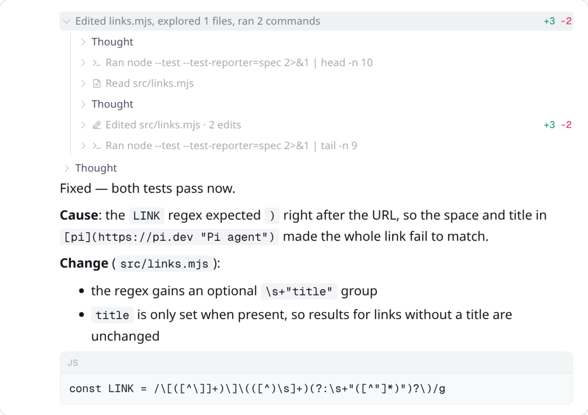

Markdown, kod blokları, KaTeX ve uzun çıktılar yerinde işlenir. Bir mesajı kopyalamak, ona geri sarmak veya ondan yeni bir oturum çatallamak için üzerine gelin.

## İnceleme (Review)

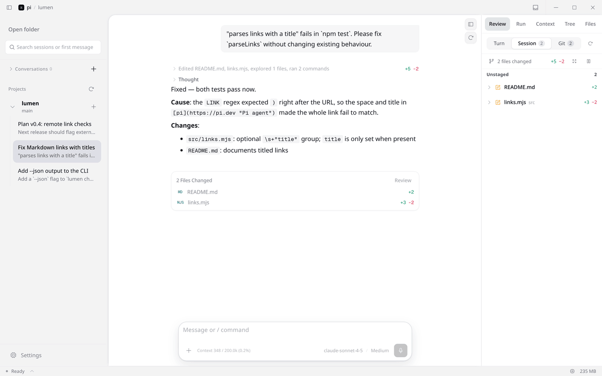

Bir kapsam seçin — bu tur, bu oturum veya tüm Git çalışma ağacı — ve diff'i için bir dosyayı genişletin; yan yana görünüm için kenar çubuğunu sürükleyerek genişletin. Değişiklik blokları (hunk) tek tek sahnelenebilir (stage) veya sahneden çıkarılabilir (unstage) ve bir satır yorumu doğrudan konuşmaya geri gönderilir.

## Dosyalar (Files)

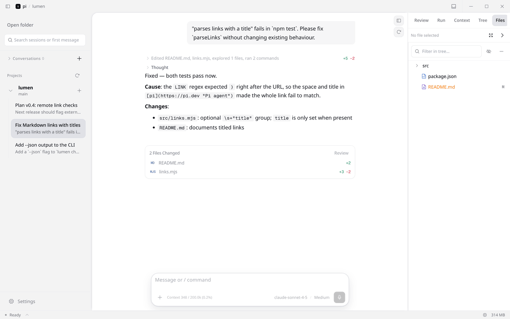

- Sohbetin yanında projeye göz atın; `Ctrl`/`⌘`+tıklama bir dosyayı başka bir sekmede açar.
- Kenar boşluğu (gutter) düğmesi `path:line` bilgisini referans olarak oluşturucuya (composer) alıntılar.
- **Expand preview** dosyaya tüm sohbet sütununu verir; geri dönmek için tekrar tıklayın. Eklemek için bir dosyayı oluşturucunun üzerine sürükleyin.

## Oluşturucu (Composer)

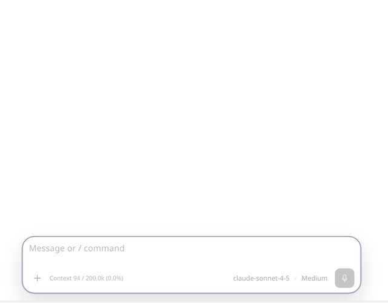

- `@` proje dosyalarını arar (`.gitignore` kurallarına uyar, `fd` kullanır) ve bunları referans olarak ekler.
- `/` pi'nin yerleşik komutlarını ve eklentilerinizin kaydettiği komutları listeler.
- Görselleri ve dosyaları yapıştırın veya bırakın; model ve düşünme düzeyi giriş alanının sağında yer alır.
- Ajan çalışırken `Enter` mevcut turu yönlendirir ve `Alt+Enter` bittiğinde çalışmak üzere bir takip mesajı kuyruğa ekler.

## Paralel oturumlar

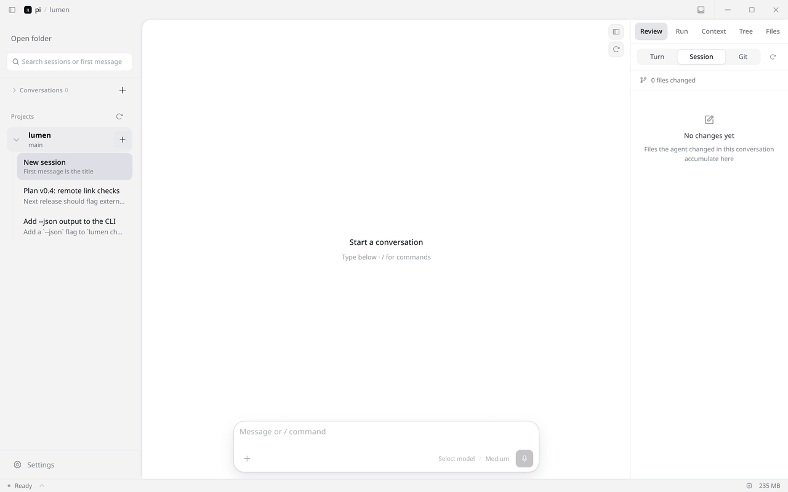

Her oturum kendi çalışanında (worker) çalışır. Bir tur başlatın, başka bir oturum açın ve ikinci bir tur başlatın: ikisi de çalışmaya devam eder, kenar çubuğu çalışanları işaretler ve durum çubuğu bunları sayar. **Settings → General**, kaç çalışanın canlı kalacağını ve boştakilerin ne zaman geri kazanılacağını ayarlar; çalışan oturumlar asla geri kazanılmaz.

## Yerleşik terminal

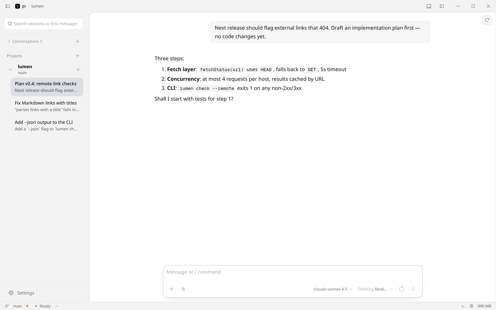

`` Ctrl+` `` geçerli projede sohbetin altından bir terminal çıkarır. `PATH` üzerinde pi'nin araçlarıyla birlikte pi'nin komutları çalıştırdığı aynı kabuğu (Windows'ta Git Bash) başlatır; **+** ayrıca PowerShell 7, Windows PowerShell, cmd, her WSL dağıtımı, zsh veya fish sunar. Sekmeler ve sekme başına en fazla dört yan yana bölme — kenarlıkları sürükleyin, bir bölmeyi **✕** veya `Ctrl+Shift+W` ile kapatın. Çekmeceyi gizlemek kabukları ve çıktılarını korur; seçilen çıktı tek tıklamayla oluşturucuya gider.

## Dallar (Branches)

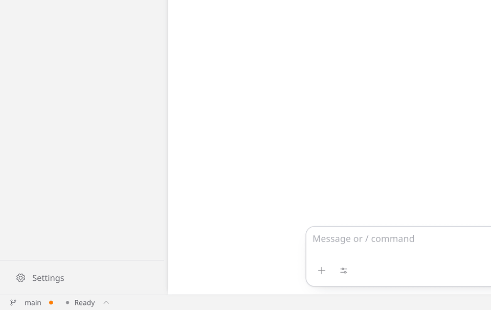

Durum çubuğu projenin dalını, işlenmemiş değişiklikleri ve önde / geride (ahead / behind) durumunu gösterir. Yerel ve uzak dalları aramak, geçiş yapmak veya `HEAD`'den yeni bir tane oluşturmak için üzerine tıklayın (veya komut paletinde **Switch branch…** kullanın). Git izin verdiğinde değişiklikler geçişle birlikte taşınır; üzerine yazılacakları durumlarda önce onları zulalayabilir (stash) ve dala geri döndüğünüzde geri yükleme teklifi alabilirsiniz. Projede hala çalışan bir oturum varsa, altında herhangi bir şey değişmeden önce size sorulur.

## Kullanım (Usage)

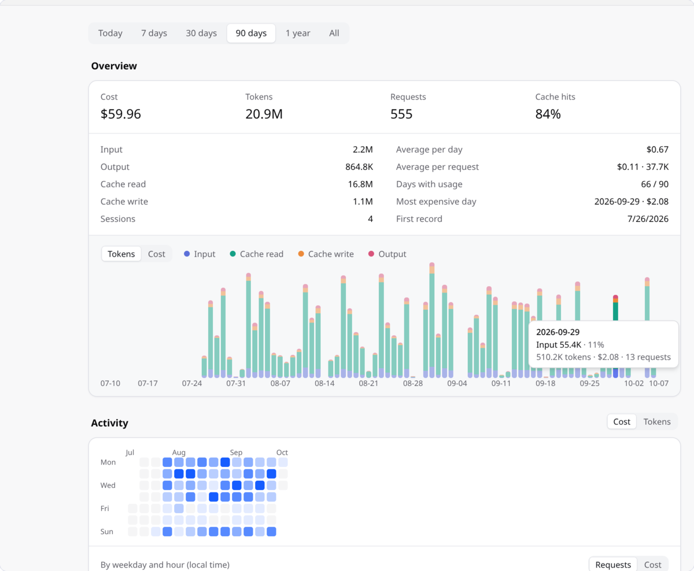

**Settings → Usage**, özel bir `sessionDir` dahil olmak üzere makinedeki her pi oturumundan — masaüstü ve terminal pi'den — tokenları ve maliyeti güne, saate, modele, projeye ve oturuma göre toplar. Payını görmek için bir günün katmanının üzerine gelin; bir çatala kopyalanan yanıtlar bir kez sayılır.

## Diğer paneller

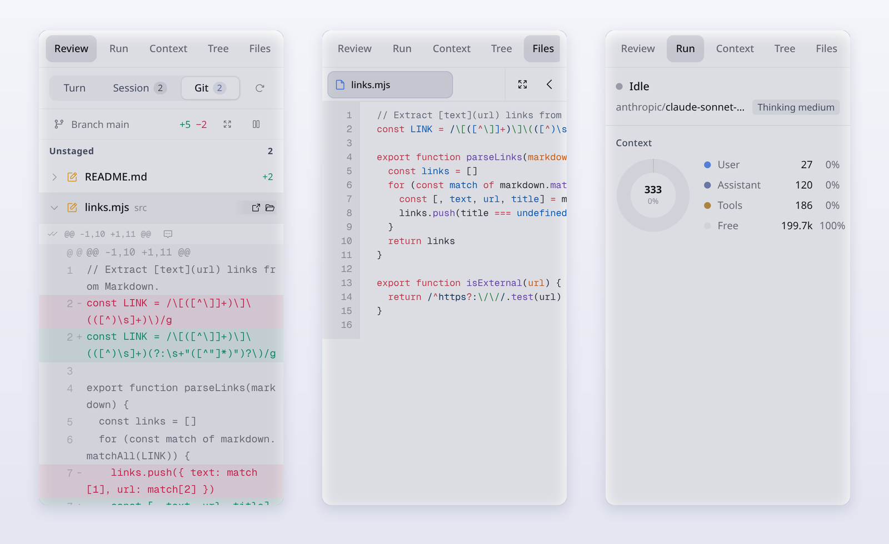

| Panel | Ne yapar |
|---|---|
| **Tree** | `pi /tree` gibi oturumu ağaç olarak gösterir: kullanıcı mesajlarına göre filtreleyin, herhangi bir düğüme geri atlayın ve oradan yeni bir dal olarak devam edin. |
| **Run** | Çalışma durumu, model ve düşünme düzeyi ve bağlam penceresinin kullanıcı, asistan ve araç mesajları arasında nasıl bölündüğü. |
| **Context** | Girdi başına token tahminleriyle mevcut bağlamı oluşturan mesajlar. |

## Temalar ve arka plan

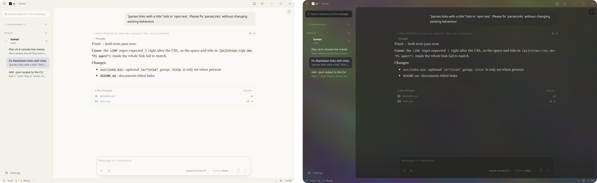

Açık ve koyu modların her biri bir ön ayar alır — **Claude**, VS Code Light+, Codex Dark — veya kendinizinkini oluşturabilirsiniz: kenar çubuğu, sohbet, mesajlarınız, kod blokları ve kenarlıklar için renkler, bir başlık / yanıt yazı tipi (serif dahil), sohbet metin boyutu ve satır yüksekliği, köşe yarıçapı ve gölge. Her şey özel CSS düzenleyicisinin yanında listelenen bir CSS değişkenidir. Pencerenin arkasına mod başına veya paylaşılan bir arka plan görseli yerleştirilebilir; gücü, bulanıklığı ve bölmelerin opaklığı ayarlanabilir; metin her zaman buzlu bir yüzey üzerinde kalır. Temalar `pi-theme-v1` / `codex-theme-v1` dizelerinden içe aktarılır; beş simge seti ve %90–110 yoğunluk da **Settings → Appearance** altındadır.

## Telefonunuzda pi

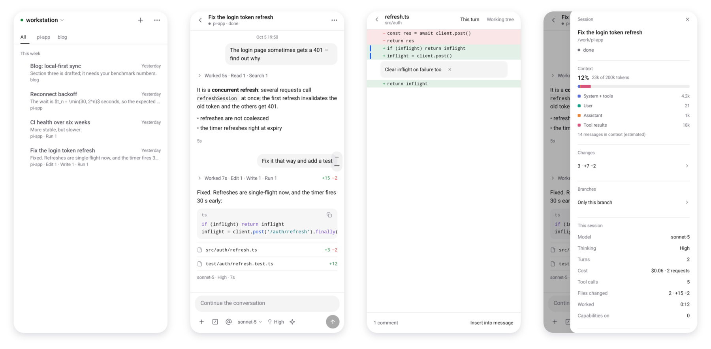

**pi Remote** (Android) masaüstü uygulamasına bağlanır: **Settings → Mobile**'ı açın, QR kodunu tarayın ve her oturum telefonda olsun — bir tur çalışırken takip edin, sorularını yanıtlayın, görsellerle istem gönderin, modeli ve düşünme düzeyini seçin. Bir turun değişikliklerini veya çalışma ağacını dosya dosya inceleyin, bir sonraki mesajınıza gidecek yorumlar bırakmak için satırlara uzun basın, oturumun dalını değiştirin veya herhangi bir mesajdan çatallayın. Bağlantı uçtan uca şifrelidir ve ağınızda kalır; evden uzaktayken her iki cihazı da aynı Tailscale / ZeroTier / WireGuard ağına koyun (uygulama kaplama adresini bulur veya elle bir tane ekleyin). İngilizce ve Çince telefonun dilini izler, uygulama içi geçersiz kılma seçeneği vardır.

## Nasıl bir araya gelir

<picture>
  <source media="(prefers-color-scheme: dark)" srcset="doc/assets/readme/en/architecture-dark.png" />
  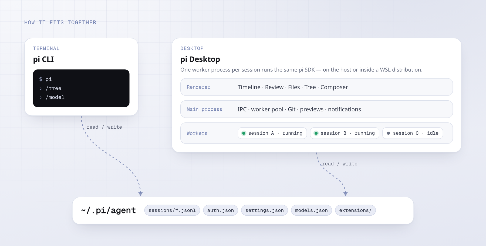
</picture>

İşleyici (renderer) doğrudan SDK ile konuşmaz: ana süreç her isteği oturumun sahibi olan çalışana yönlendirir ve o çalışan pi SDK'yı makinenizde veya bir WSL dağıtımı içinde çalıştırır. Oturumlar, girişler ve ayarlar `~/.pi/agent` içinde kalır, böylece CLI ve uygulama aynı oturum üzerinde sırayla çalışabilir.

## Ayrıca dahil olanlar

| | |
|---|---|
| **Eklentiler, değişmeden** | Terminal pi için yüklediğiniz eklentiler burada yüklenir. İletişim kutuları, araç kartları, paneller ve `/komutlar` bildirimsel adaptörlerle yerel arayüze eşlenir — 36 tanesi yerleşik olarak gelir. [Liste](./doc/guide/adapters.en.md) |
| **Bildirimler** | Bir tur bittiğinde veya girdi gerektirdiğinde sistem bildirimi ve uygulama içi gelen kutusu; durum çubuğu neyin çalıştığını gösterir. |
| **WSL çalışma zamanı** (Windows) | Oturumlar, Git ve önizlemeler Linux tarafında çözümlenecek şekilde çalışanı seçilen bir WSL dağıtımı içinde çalıştırın. |
| **Çince / İngilizce Arayüz** | Ayarlar'dan değiştirin; telefon uygulaması sistem dilini izler. |
| **Güncellemeler** | Arka planda GitHub Releases'ı kontrol eder ve yükleyiciyi indirip başlatabilir. |

## Kurulum

| Platform | Paket |
|---|---|
| Windows x64 | `pi.Desktop-Setup-<version>-x64.exe` (yükleyici) veya `pi.Desktop-Portable-<version>-x64.exe` |
| macOS | Apple Silicon (`arm64`) ve Intel (`x64`) için `.dmg` / `.zip` |
| Linux x64 | `.AppImage` veya `.deb` |
| Android 9+ (arm64) | `pi-remote-<version>-android-arm64.apk` — telefon uygulaması |

Bunları [Releases](https://github.com/justhil/pi-app/releases/latest) sayfasından edinin; her sürüm `SHA256SUMS.txt` içinde SHA-256 sağlama toplamlarını listeler. Uygulama kendi pi SDK'sını paketler; bir model sağlayıcısına yalnızca bir kez, terminal pi için yaptığınız gibi oturum açmanız yeterlidir (kimlik bilgileri `~/.pi/agent` içinde yaşar). Settings → Runtime genel olarak yüklü bir pi sürümüne geçiş yapabilir.

<details>
<summary>Kaynaktan derle</summary>

Node.js ≥ 22.19 gerektirir.

```bash
git clone https://github.com/justhil/pi-app.git
cd pi-app
npm install
npm run dev          # geliştirme
npm run build        # out/ içinde üretim paketi
npm run package      # electron-builder aracılığıyla yükleyiciler
```

</details>

## İlk beş dakika

1. **Klasör aç** — klasör ajanın çalışma dizini olur. Tek seferlik bir sohbet için bunun yerine *Conversations* yanındaki **+** düğmesini kullanın.
2. **Bir oturum seç** — o klasör için terminal pi'den gelen oturumlar listelenir; projenin yanındaki **+** yeni bir tane başlatır.
3. **Gönder** — `Enter` gönderir, `Shift+Enter` satır ekler.
4. **Sağa bak** — Review, Run, Context, Tree ve Files sağ kenar çubuğunu paylaşır; genişletmek için kenarını sürükleyin.
5. **Geri git** — geri sarmak veya çatallamak için bir mesajın üzerine gelin ya da oturum ağacını açmak için boş bir oluşturucuda iki kez `Esc` tuşuna basın.

## Kısayollar

| Eylem | Tuşlar |
|---|---|
| Gönder / yeni satır | `Enter` / `Shift+Enter` |
| Çalışan turu yönlendir / takip kuyruğa ekle | Çalışırken `Enter` / `Alt+Enter` |
| Kuyruktaki son mesajı geri çek | `Alt+↑` |
| Durdur | `Esc` |
| Oturum ağacı | Boş oluşturucuda `Esc` `Esc` |
| Önceki / sonraki gönderilen mesaj | Boş oluşturucuda veya imleç başta / sondayken `↑` / `↓` |
| Dosya referansı / komut | `@` / `/` |
| Bir dosyayı yeni sekmede aç | Files içinde `Ctrl`/`⌘`+tıklama |
| Terminali göster / gizle | `` Ctrl+` `` |
| Odaklanılan terminal bölmesini kapat / içinde bul | `Ctrl+Shift+W` / `Ctrl+Shift+F` (macOS'ta `⌘W` / `⌘F`) |

## Eklentiler

Eklentileri tıpkı terminal pi için olduğu gibi yükleyin ve etkinleştirin:

```bash
pi install npm:<package>      # veya: pi install git:github.com/<owner>/<repo>
```

ardından paketin `~/.pi/agent/settings.json` → `packages` içinde etkinleştirildiğinden emin olun ve yeni bir oturum başlatın. **Settings → Extensions** mevcut çalışanın ne yüklediğini gösterir; **Settings → Adapters** her adaptörün masaüstü seçeneklerini tutar. Bir adaptörü geçersiz kılmak veya eklemek için `~/.pi/desktop/adapters/` (veya öncelikli olan `<project>/.pi/desktop/adapters/`) içine bir `.json` adaptör dosyası koyun — [yazma kılavuzuna](./doc/adapter-authoring-guide.md) bakın.

<details>
<summary>Sesli giriş</summary>

Oluşturucudaki mikrofon düğmesi konuşmayı giriş alanına yazıya döker. Varsayılan olarak, Codex / ChatGPT oturum açmanızla ChatGPT'nin transkripsiyon uç noktasını çağıran yerleşik hizmeti kullanır — OpenAI API anahtarı ve yerel süreç gerekmez. **Settings → Voice** içinde bir `access_token` yapıştırın veya `~/.codex/auth.json` (`codex login` tarafından yazılır) dosyasından içe aktarın, ardından **Verify login**'e tıklayın.

*Advanced* altında bunun yerine yerel bir [codex-asr](https://github.com/Wangnov/codex-asr) CLI veya kendi `codex-asr serve` URL'nizi kullanabilirsiniz. Yazma işlemi ses olmadan da her zaman çalışır.

</details>

<details>
<summary>SSS</summary>

| Sorun | Deneyin |
|---|---|
| Bir eklenti Ayarlar'da listeleniyor ama sohbette eksik | `packages` içinde etkinleştirin, ardından yeni bir oturum başlatın. |
| Uzun bir oturuma ilk geçiş yavaş | Önce yalnızca en son mesajlar yüklenir; geri kalanı kaydırıldığında veya gönderdiğinizde yüklenir. |
| Bir eklenti iletişim kutusu yanlışlıkla kapatıldı | Zaman çizelgesi kartındaki **Continue** düğmesini kullanın. |
| Sesli giriş oturum açmanın geçersiz olduğunu söylüyor | Token süresi dolmuş — tekrar `codex login` çalıştırın ve yeniden içe aktarın. |
| Kaynak kodu değiştirdikten sonra boş pencere | `node_modules/.vite` klasörünü silin ve `npm run dev` komutunu yeniden çalıştırın. |

</details>

<details>
<summary>Geliştiriciler için</summary>

- Yığın: Electron 43 · React 18 · TypeScript · Tailwind · Zustand · i18next · xterm.js · `@earendil-works/pi-coding-agent`
- Süreçler: Electron ana süreci (IPC, çalışan havuzu, Git, önizlemeler) → pi SDK'yı çalıştıran oturum başına bir yardımcı süreç çalışanı → işleyici (renderer).
- Kontroller: `npm run test:unit`, `npm run test:scripts`, `npm run typecheck`, `npm run lint`
- Belgeler: [`doc/`](./doc/README.md) · [adaptör yazma](./doc/adapter-authoring-guide.md) · [değişiklik günlüğü](./CHANGELOG.md)
- Telefon uygulaması: [`apps/mobile`](./apps/mobile) içinde Kotlin / Compose; `node scripts/remote-dev-host.mjs` karşı geliştirme yapmak için sahte bir masaüstü çalıştırır.
- Sürümler: bir `v*` etiketi göndermek `.github/workflows/release.yml` iş akışını çalıştırır ve Windows, macOS, Linux ve Android paketlerini derler.

</details>

## Destek

Sorular ve geri bildirim: [LinuxDo](https://linux.do/) veya [GitHub Issues](https://github.com/justhil/pi-app/issues). Uygulama işinize yarıyorsa bir ⭐ diğer pi kullanıcılarının onu bulmasına yardımcı olur ve aşağıdaki QR koduyla bakıma sponsor olabilirsiniz.

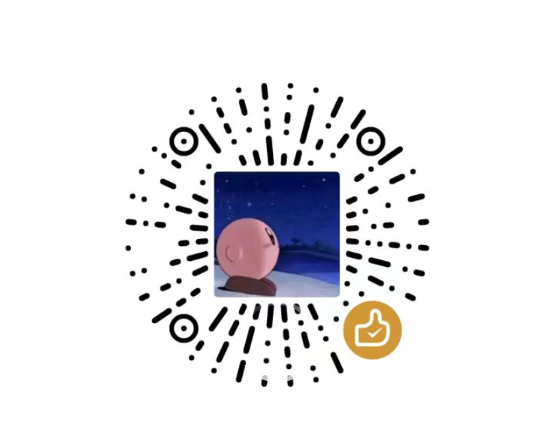

## Lisans

[MIT](LICENSE)
